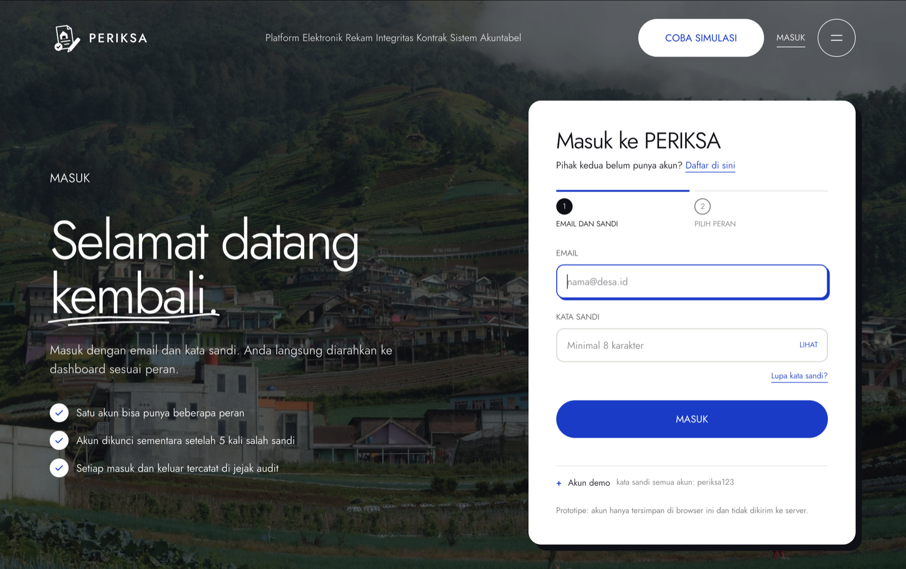
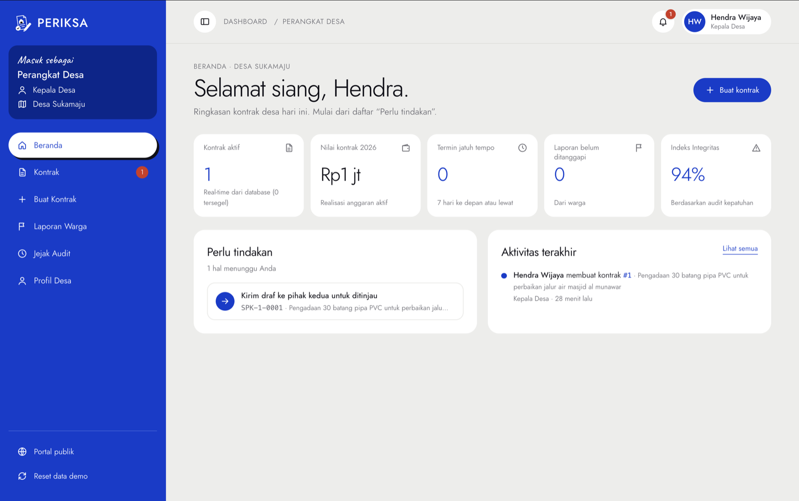
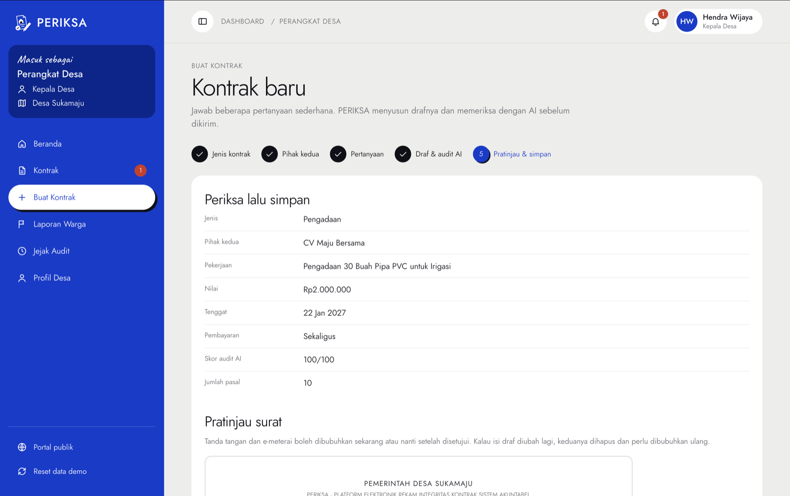
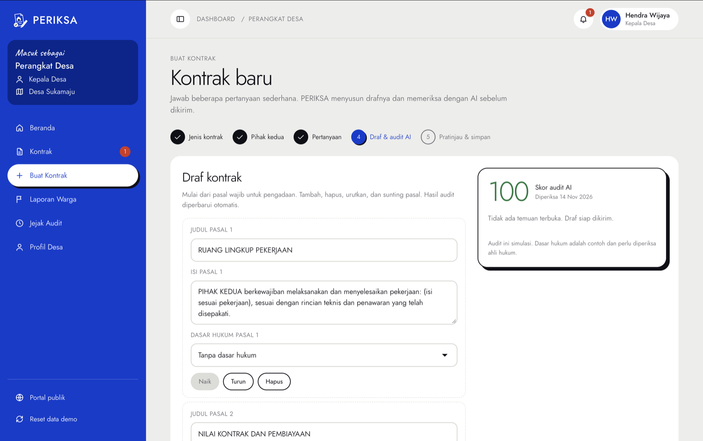
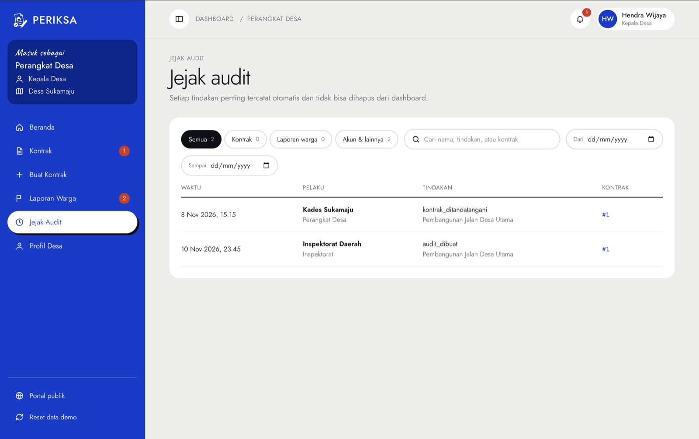
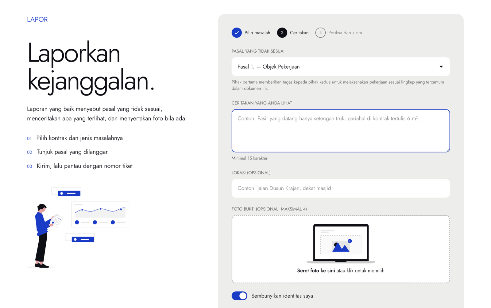
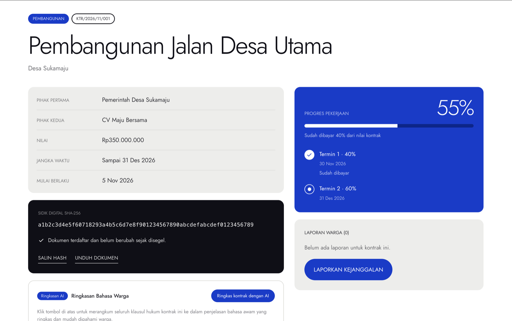
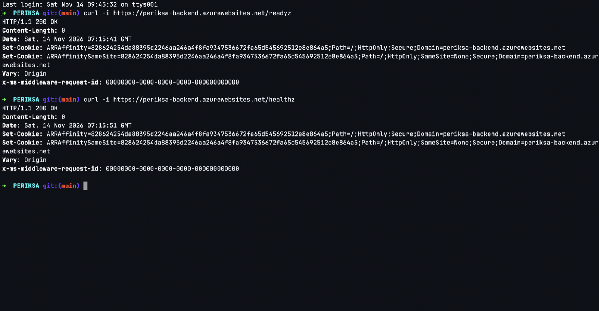

# PERIKSA (Platform Elektronik Rekam Integritas Kontrak Sistem Akuntabel)

**PERIKSA** adalah platform kontrak digital cerdas dan akuntabel yang dirancang untuk membantu pemerintah desa, UMKM, dan penyedia jasa menyusun, mengaudit, menandatangani, serta mengawasi perjanjian kontrak kerja sama secara transparan, sah menurut hukum, dan anti-pemalsuan.

Panduan instalasi, hasil pengujian, API, demo langsung, AI, dan deployment tersedia di [docs/panduan-periksa.md](docs/panduan-periksa.md).

## Demo Langsung

| Komponen | URL |
|---|---|
| Frontend production | [https://periksaid.vercel.app](https://periksaid.vercel.app) |
| Backend API | [https://periksa-backend.azurewebsites.net](https://periksa-backend.azurewebsites.net) |
| API health check | [https://periksa-backend.azurewebsites.net/healthz](https://periksa-backend.azurewebsites.net/healthz) |
| API readiness check | [https://periksa-backend.azurewebsites.net/readyz](https://periksa-backend.azurewebsites.net/readyz) |

### Akun Demo

Semua akun demo menggunakan password `periksa123`.

| Email | Role | Kegunaan |
|---|---|---|
| `tester@periksa.id` | Multi-role | Mencoba alur utama aplikasi |
| `kades@periksa.id` | Kades | Membuat dan mengelola kontrak |
| `penyedia@periksa.id` | Penyedia | Meninjau dan menindaklanjuti kontrak |
| `warga@periksa.id` | Warga | Membuat laporan masyarakat |
| `bpd@periksa.id` | BPD | Mengawasi kontrak desa |
| `inspektorat@periksa.id` | Inspektorat | Melihat audit dan laporan pengawasan |

---

## 🚀 Alur Kerja Utama

1. **Kuisioner Cerdas (Smart Q&A):** Pengguna menjawab pertanyaan terpandu untuk menentukan parameter kontrak.
2. **Penyusunan & Audit Kontrak Berbasis AI:** AI menyusun draf perjanjian sesuai template hukum dan mengaudit kelengkapan klausul wajib serta potensi risiko klausul liar.
3. **Peninjauan Kolaboratif & Persetujuan:** Kontrak ditinjau oleh kedua belah pihak (Desa & Penyedia) dengan fitur catatan dan revisi transparan.
4. **Tanda Tangan Elektronik & e-Meterai:** Penandatanganan kontrak digital yang sah berkekuatan hukum.
5. **Segel Integritas Kriptografis (Audit Trail):** Pencatatan hash dokumen (SHA-256) untuk menjamin deteksi instan terhadap setiap perubahan atau pemalsuan pasca-penandatanganan.
6. **Penerbitan Kontrak Publik (Redaksi Data Pribadi/PII):** Kontrak dapat dipublikasikan untuk transparansi publik setelah informasi sensitif (PII) disaring dan disamarkan secara otomatis oleh modul AI.
7. **Pengawasan Warga & Kanal Pelaporan:** Warga masyarakat dapat memantau progres pelaksanaan di lapangan dan mengirimkan laporan pengaduan jika terjadi ketidaksesuaian.

---

## 📂 Struktur Repositori (Monorepo)

```text
periksa/
├── frontend/    # Antarmuka web pengguna (Next.js 16, React 19, TypeScript, Tailwind CSS)
├── backend/     # API Gateway & Core Business Logic (Golang 1.23, PostgreSQL, Redis, gRPC Client)
├── ai-engine/   # Layanan Cerdas LLM & NLP (Python 3.10+, FastAPI, gRPC Server, Google Gemini)
├── proto/       # Definisi Kontrak Komunikasi Antar-Layanan (Protocol Buffers / gRPC)
└── docs/        # Dokumentasi arsitektur, PRD, dan Postman collection
```

---

## 🌿 Strategi Branching Tim

Repositori ini menggunakan strategi branch berbasis fitur untuk masing-masing domain tim:

| Branch | Deskripsi / PIC | Lokasi Kerja |
| :--- | :--- | :--- |
| `main` | Production-ready boilerplate, konfigurasi root, dan kontrak global | Root, `proto/`, `docs/` |
| `feat/frontend` | Implementasi antarmuka pengguna web | `frontend/` |
| `feat/backend` | Implementasi backend REST API, PostgreSQL, Redis, dan integrasi | `backend/` |
| `feat/ai-engine` | Implementasi engine AI, chain LLM, PII redaction, dan gRPC server | `ai-engine/` |

---

## 🛠️ Memulai Cepat (Quickstart)

### Menggunakan Docker Compose
```bash
# Jalankan seluruh stack (Database, Cache, Backend, AI Engine, Frontend)
docker compose up --build
```

Layanan lokal akan berjalan pada:
- **Frontend**: http://localhost:3000
- **Backend API**: http://localhost:8080
- **AI Engine (REST / Docs)**: http://localhost:8000/docs
- **AI Engine (gRPC)**: localhost:50051
- **PostgreSQL**: localhost:5432
- **Redis**: localhost:6379

## Hasil Pengujian API Production

Pengujian dilakukan pada 14 November 2026 menggunakan endpoint production dan skenario dari koleksi Postman `docs/periksa-api.postman_collection.json`.

Base URL:

```text
https://periksa-backend.azurewebsites.net/api/v1
```

| Skenario | Hasil |
|---|---|
| `GET /healthz` | HTTP 200 |
| `GET /readyz` | HTTP 200 |
| Login akun tester | HTTP 200 |
| `GET /auth/me` | HTTP 200 |
| `GET /dashboard/metrics` | HTTP 200 |
| `GET /contracts` | HTTP 200 |
| `GET /reports` | HTTP 200 |
| `GET /notifications` | HTTP 200 |
| `GET /public/contracts` | HTTP 200 |
| `GET /public/seals/verify` | HTTP 200 |
| Login akun demo kades, penyedia, inspektorat, dan warga | HTTP 200 |
| `GET /audit-logs` dengan role kades, penyedia, dan inspektorat | HTTP 200 |
| `GET /audit-logs` dengan role warga | HTTP 403 sesuai pembatasan akses |

Pengujian lengkap beserta daftar kelompok endpoint tersedia di [docs/panduan-periksa.md](docs/panduan-periksa.md).

## Ringkasan API

Semua endpoint aplikasi menggunakan prefix:

```text
https://periksa-backend.azurewebsites.net/api/v1
```

Endpoint yang membutuhkan login menggunakan header:

```http
Authorization: Bearer <authToken>
```

| Kelompok | Endpoint utama | Fungsi |
|---|---|---|
| Autentikasi | `POST /auth/login`, `POST /auth/register`, `GET /auth/me` | Login, registrasi, dan profil pengguna |
| Dashboard | `GET /dashboard/metrics` | Ringkasan aktivitas pengguna |
| Kontrak | `GET /contracts`, `POST /contracts`, `GET /contracts/{id}` | Membuat dan mengelola kontrak |
| Wizard AI | `POST /contracts/wizard/questions`, `POST /contracts/wizard/preview` | Membuat pertanyaan dan preview kontrak |
| Audit AI | `POST /contracts/audit`, `GET /contracts/{id}/audit/latest` | Memeriksa klausul dan risiko kontrak |
| Review dan tanda tangan | `POST /contracts/{id}/reviews`, `POST /contracts/{id}/sign` | Review serta persetujuan para pihak |
| Termin dan progres | `GET /termin`, `PUT /contracts/{id}/termin`, `POST /contracts/{id}/progress` | Pembayaran dan pelaporan progres |
| Laporan warga | `POST /reports`, `GET /reports`, `GET /reports/{id}` | Pengaduan dan tindak lanjut |
| Audit trail | `GET /audit-logs`, `GET /seals` | Riwayat aktivitas dan segel dokumen |
| API publik | `GET /public/contracts`, `GET /public/seals/verify` | Melihat kontrak dan memverifikasi segel |

Koleksi request siap pakai tersedia di [docs/periksa-api.postman_collection.json](docs/periksa-api.postman_collection.json). Dokumentasi API yang lebih lengkap ada di [docs/panduan-periksa.md](docs/panduan-periksa.md).

## Galeri Demo dan Thumbnail

Gambar berikut disiapkan sebagai tempat thumbnail dokumentasi. Tambahkan screenshot dengan nama file yang sama ke folder [`docs/screenshots`](docs/screenshots/). Gunakan gambar berukuran 1600 × 900 agar tampilan README tetap rapi.

| Tampilan | Thumbnail |
|---|---|
| Login |  |
| Dashboard |  |
| Wizard kontrak |  |
| Audit AI |  |
| Jejak audit |  |
| Laporan warga |  |
| Kontrak publik |  |
| Health API |  |

> Sebelum mengunggah screenshot, samarkan token, password, email pribadi, nomor telepon, NPWP, nomor rekening, dan data sensitif lainnya. Lihat [template screenshot](docs/screenshots/README.md) untuk daftar nama file dan panduan pengambilan gambar.

## Arsitektur Production

```text
Pengguna
   |
   v
Vercel — Next.js Frontend
   |
   v
Azure App Service — Go Backend API
   |                  |
   v                  v
Azure PostgreSQL   Azure Container Instances — AI Engine
                   FastAPI, gRPC, Gemini/Groq
```

Deployment berjalan melalui GitHub Actions. Backend menggunakan Azure App Service Linux, AI engine berjalan sebagai container di Azure Container Instances, database menggunakan Azure Database for PostgreSQL Flexible Server, dan image container disimpan di Azure Container Registry.
